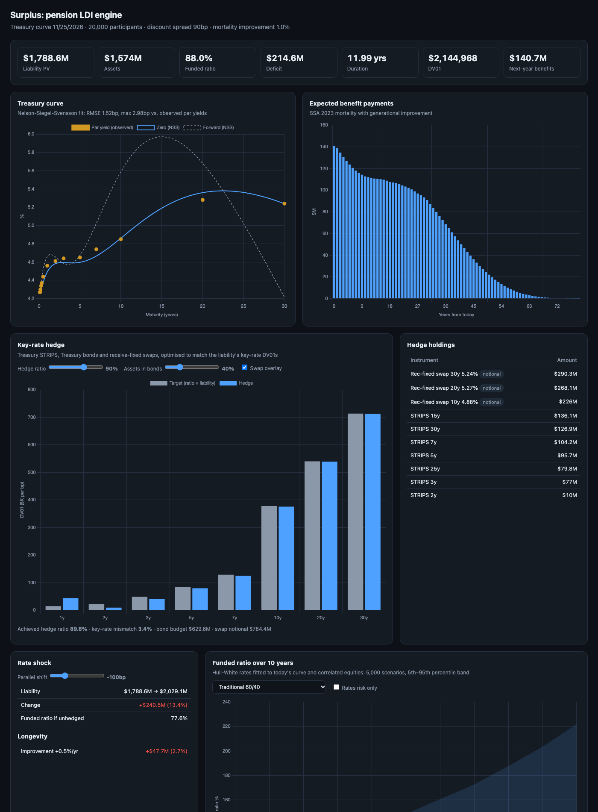

# Surplus: Pension LDI & Funded-Status Risk Engine

A liability-driven investing (LDI) engine for a frozen corporate defined-benefit pension plan, built on real market and
mortality data. It values the pension liability off today's Treasury curve, measures its key-rate interest-rate risk,
builds an optimized hedge from Treasury STRIPS, Treasury bonds and swaps, and projects the plan's funded status through
10,000 Hull-White interest-rate scenarios to compare investment strategies. A Claude-powered analyst answers questions
by calling the engine, and **every number it reports is audited against the tool results it actually received**.



## Results (Treasury curve 11/25/2026, synthetic 20,000-participant plan)

| | |
|---|---|
| Liability PV | **$1,788.6M** (assets $1,574.0M, 88.0% funded) |
| Effective duration / DV01 | **11.99 years**, $2.14M per bp |
| Rates −100bp | liability **+$240.5M (+13.4%)**, unhedged funded ratio falls to 77.6% |
| Longevity: +0.5%/yr mortality improvement | liability +$47.7M (+2.7%) |
| Curve fit | Nelson-Siegel-Svensson, **1.52bp RMSE** vs. observed par yields |
| 90% hedge with 40% of assets in bonds | 89.8% achieved, 3.4% key-rate mismatch, $784M swap overlay |

**Interest-rate risk only** (equity volatility switched off, 10,000 scenarios, 10 years):

| Strategy | 1-yr surplus VaR95 | 5th pct funded ratio, yr 10 | PV of contributions |
|---|---|---|---|
| Traditional 60/40 | 9.4% | 87.1% | $115.1M |
| LDI 60/40, long bonds | 6.1% | 91.5% | $100.7M |
| **LDI 60/40 + swaps, 90% hedge** | **0.6%** | **102.6%** | **$78.8M** |
| Glide path | 4.0% | 95.9% | $105.4M |

The 90% hedge cuts rate-driven surplus VaR by **93%** versus a traditional 60/40 portfolio and lowers expected sponsor
contributions by 32%. With equity risk included, equities dominate surplus risk (VaR 12.7–14.6% across the static
strategies). The funded-ratio glide path has the lowest full-risk VaR (11.2%), lowest chance of ending below 80% funded
(11.4%) and lowest contributions ($149.6M). Reproduce: `python -m surplus.report` (about 1.5 s).

## How it works

```
 Treasury par yields ──► bootstrap ──► Nelson-Siegel-Svensson zero curve ─┐
 (treasury.gov CSV)                                                       │
 SSA 2023 life table ─► generational mortality ─► benefit cash flows ─────┼─► PV, duration, convexity,
 synthetic census (retirees / deferred / frozen actives)                  │   key-rate DV01s (8 tenors)
                                                                          │
                       hedge optimizer (SLSQP) ◄──────────────────────────┤
                       STRIPS + bonds within the bond budget,             │
                       swaps for the rest of the hedge                    │
                                                                          ▼
 Hull-White 1-factor (exact simulation, fitted to the curve) + correlated equities
   └─► every half year, in every scenario: revalue the liability, bonds and swaps in closed form,
       pay benefits, take sponsor contributions, rebalance to the strategy, re-strike the swap overlay
       └─► funded-ratio distribution, surplus VaR/CVaR, PV of contributions, realised hedge ratio
```

| Module | What it does |
|---|---|
| `curve.py` | Loads the Treasury daily par curve, bootstraps discount factors on a semiannual grid (reprices every par bond to 1e-10), fits NSS with multi-start least squares. |
| `mortality.py` | SSA 2023 period life table with generational improvement `q(x, y) = q₂₀₂₃(x)(1 − i)^(y−2023)`. |
| `plan.py` | Synthetic census and expected annuity payments by (age, sex) cohort, with mid-year payments under uniform distribution of deaths. |
| `liability.py` | PV, effective duration/convexity, key-rate durations from triangular bumps that sum exactly to the parallel duration, longevity sensitivity. |
| `hedge.py` | Builds 11 STRIPS/T-bills, 5 par bonds and 3 receive-fixed swaps, then solves a constrained least-squares problem for the key-rate hedge. |
| `esg.py` | Hull-White with θ(t) fitted to the curve. The short rate and its integral are sampled *jointly and exactly* (bivariate normal), so the discount factor is an exact martingale with no time-step error. Bond prices at any node use the closed form. |
| `simulate.py` | Asset/liability projection with annual rebalancing, PPA-style 7-year deficit amortization, swap overlay sizing by model delta, and glide-path triggers. |
| `analyst.py` | Claude (`claude-opus-5-5`) with 5 strict-schema tools over the engine, a manual agent loop, server-side refusal fallback, and a grounding audit that flags any number not traceable to a tool result. |
| `evals.py` | 10-question accuracy eval: the expected answers are computed by the engine and graded numerically, together with the grounding score. |
| `api.py`, `web/` | FastAPI service and a Chart.js dashboard (curve, cash flows, key-rate hedge, rate shocks, funded-ratio fan chart, analyst). |

## Verification

The 20 tests (`pytest`, about 2 s) check closed-form properties rather than snapshot numbers:

- **Bootstrap** reprices every observed par bond exactly; NSS stays within 3bp RMSE.
- **Forward rates** integrate back to the discount factor.
- **Zero-coupon duration** equals maturity (exactly, after the finite-difference correction).
- **Key-rate durations** sum to effective duration.
- **Level annuity** under flat rates and flat mortality matches the geometric-series closed form.
- **Hull-White:** E[D(0,T)] = P(0,T) within 4 standard errors at 5, 10, 20 and 30 years. E[D(0,t)·P(t,T)] = P(0,T) checks the closed-form bond price.
- **Perfect immunization:** a cash-flow-matched plan stays at exactly 100.000000% funded in every scenario. Any bookkeeping error in benefit payments, coupons or revaluation would break this.
- **Swap overlay** delivers exactly the requested hedge ratio at every rebalance.
- **Hedging** cuts rate-driven surplus volatility by more than 75%.
- **Analyst:**
  - Every tool runs and returns JSON, and every tool schema is strict.
  - The grounding audit accepts real numbers and flags invented ones.
  - The agent loop is exercised with a scripted client, including how tool errors are handled.

## Run it

```bash
python3.12 -m venv .venv && .venv/bin/pip install -e ".[dev]"
.venv/bin/pytest
.venv/bin/python -m surplus.report
.venv/bin/uvicorn surplus.api:app --port 8040     # dashboard at http://localhost:8040
export ANTHROPIC_API_KEY=...                       # optional: AI analyst and eval
.venv/bin/python -m surplus.analyst "How exposed is the plan to falling rates?"
.venv/bin/python -m surplus.evals
```

## Assumptions and limitations

- **Discount curve:** liabilities use Treasuries plus a flat 90bp spread as a stand-in for the AA corporate curve used in US GAAP pension accounting. Because a Treasury hedge doesn't earn that spread, the hedged strategies show lower median funded ratios. That is the reason real LDI portfolios hold long corporate bonds; credit spread risk isn't modeled yet.
- **Swaps** are priced off the Treasury curve; SOFR swap spreads are ignored.
- **Hull-White parameters** (a = 5%, σ = 1%) are typical market values, not calibrated to swaption volatilities. Rates evolve without a term premium, and equities earn the short rate plus a 4% premium at 16% volatility, with a −0.2 correlation to rate moves.
- **Benefits:** frozen single-life annuities from age 65; no lump sums, spouse benefits or COLAs. Mortality improvement is a single flat rate rather than the full SOA MP-2021 scale.
- **The census is synthetic** (seeded), so no real participant data is used.

## Data

- U.S. Treasury Daily Par Yield Curve Rates, 2026 (home.treasury.gov).
- Social Security Administration, Office of the Chief Actuary: Actuarial Life Table (2023 period life table).
